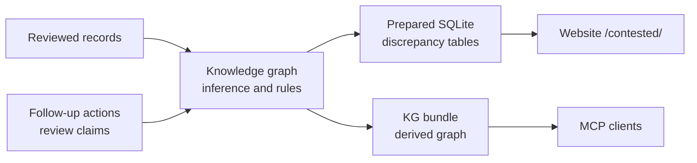

# Rewire benchmark data

Reviewed benchmark results for omics and molecular models, the source evidence behind every value, and the procedures for collecting, reviewing and releasing them.

Every release also checks the evidence against itself: where one study ranks or scores models differently from the other studies of the same models, the release flags it as a discrepancy and publishes what we are doing to resolve it. See [Discrepancies between studies](#discrepancies-between-studies).

The website and API that display this data live in [rewire-database](https://github.com/rewire-bio/rewire-database). Benchmark execution lives in [rewire-benchmarks](https://github.com/rewire-bio/rewire-benchmarks). This repository is public and holds no credentials or private submissions.

## Collecting and updating data

| Document | What it covers |
| --- | --- |
| [docs/collection.md](docs/collection.md) | The collection procedure: search, capture sources, extract, review, validate. Start here. |
| [docs/record-contract.md](docs/record-contract.md) | Record kinds and fields |
| [docs/use-cases.md](docs/use-cases.md) | Use-case definitions, mappings and how to change them |
| [docs/evidence-tables.md](docs/evidence-tables.md) | The per-claim evidence export |
| [docs/refresh.md](docs/refresh.md) | The bounded monthly refresh cycle |
| [docs/release.md](docs/release.md) | When and how to cut a release |
| [docs/discrepancies.md](docs/discrepancies.md) | Discrepancies between studies: how they are inferred, served and followed up |
| [docs/linked-data.md](docs/linked-data.md) | Ontology mapping, vocabulary, inference and the knowledge-graph bundle for MCP clients |
| [docs/serving-contract.md](docs/serving-contract.md) | Prepared release file the website and API read (issue #31) |
| [docs/reviews/](docs/reviews/README.md) | Dated evidence reviews: search logs and value-by-value checks |

Agent skills in [.agents/skills/](.agents/skills) (also linked from `.claude/skills`):

- `literature-search`: find published results and log every search
- `extract-evaluations`: turn a pinned source into records with exact values and locators
- `review-evidence`: independently check an extracted batch and record the review
- `database-refresh`: run the monthly cycle using the three skills above

## Layout

```
data/
  entities/                            canonical records, one JSONL file per kind (models, benchmarks, sources, ...)
  evidence/                            evaluations, results and claims, each in 16 shards by ID hash
  provenance/records/                  per-record hash, originating batch and reviewed changes (16 shards)
  ontology/                            RDF mapping, JSON-LD context, vocabulary, pinned imports and SHACL shapes
  omics/
    <batch folders>/                   evidence for each extraction: receipts, retrieval logs, archived sources
    use-cases/                         use-case definitions and mappings
    pending-review/                    extractions not yet ready for the store
    search-ledger.jsonl, scope-audit.jsonl   searches and scope decisions
    audits/                            append-only audit runs
    releases/                          a receipt .json for every release (release files are built or fetched here, not committed)
    release-config.json                released_at for the current release
  benchmark-literature/                paper-reported results table (see its README)
  research/                            research investigation inputs (see its README)
docs/                                  procedures and dated reviews
scripts/omics/                         record store, extraction, acquisition, audit and release code
shared/omics/                          record validation, query engine and prepared-file reader, mirrored by the website
lib/                                   rendering helpers shared with the website
maintenance/                           refresh schedule, attempt records and reports
website/                               manifest of the packaged inputs pinned by the website (files/ is build output)
```

Records are edited only through the store: `npm run records -- add` appends a reviewed batch, `npm run records -- change` records a reviewed edit, and `npm run records -- check` verifies every record against its provenance. See [docs/collection.md](docs/collection.md).

`shared/omics/` is the source of truth for the code the website mirrors at the same path (its tests are in `tests/shared/`); there is no running service here. The website copies it with `npm run shared:sync` when it adopts a release. Changes to shared schemas need compatibility checks in both repositories.

## Build and validate

Requires Node 22 or newer. The Python tests need Python 3; the SHACL check (`records -- add`, `npm run kg:shapes`), the knowledge-graph build and the release build (`npm run build:release`) need [uv](https://docs.astral.sh/uv/). `npm run build` needs neither.

```sh
npm ci
npm test
npm run test:python
npm run test:kg
npm run typecheck
npm run build
```

The build writes the release named by `data/omics/release-config.json`, its prepared SQLite file and the website package. Packaging refuses to change a file already archived in `data/omics/releases/`. The release files are not committed: they are published as assets of the release's `serving/<id>` GitHub release, and `npm run release:fetch` downloads a published release's files (see [docs/release.md](docs/release.md#release-files)). It does not build the knowledge graph, so its prepared file serves no discrepancies; `npm run build:release` builds the graph first, as the release workflow does ([docs/release.md](docs/release.md#knowledge-graph)).

CI runs every task at the same time on its own machine: the store check, type checking, the Python and KG tests, and the test suite split into six shards. Pull requests run the fast test set (`npm run test:fast`); main runs everything (`npm test`). The SHACL job checks the whole store against the shapes. Runs that change `data/omics/release-config.json` (a release cut by hand) also rebuild the release with `npm run build` and check the prepared file; on main, a publish job waits for all of them to pass before publishing. Releases are normally cut automatically after each merge (see [docs/release.md](docs/release.md)).

## How the website consumes releases

`website/manifest.json` lists the prepared website inputs with destination, size and SHA-256; the files are assets of the release's `serving/<release-id>` GitHub release. Each release also has a prepared SQLite file, published as the GitHub release asset `serving/<release-id>` (see [docs/serving-contract.md](docs/serving-contract.md)); the website's pages and public API read only that file. The website pins the manifest, a full git revision and the prepared file's SHA-256 in its `benchmark-data.lock.json`, verifies them and builds the file into its image, without running any build step from here. No change in this repository reaches the live site until a website PR updates that lock (see [docs/release.md](docs/release.md)).

## Discrepancies between studies

On every release the knowledge-graph build compares all reviewed results and flags a study whose results disagree with other studies of the same models: an ordering reversal against a consensus, or an outlying gap to a shared reference model. A flag is a lead to investigate, not a finding that a result is wrong, and it never withholds a result. The prepared SQLite file serves the flags, the website shows them at [benchmarks.rewirebio.io/contested/](https://benchmarks.rewirebio.io/contested/), and MCP clients can query them from the knowledge-graph bundle.

What we do about each one is recorded as a series of `discrepancy_review` claims, one per action (investigated, reported upstream, awaiting correction, and so on), and shown as a timeline beside the flag. If you know why two studies disagree, open an issue or a pull request with the evidence. [docs/discrepancies.md](docs/discrepancies.md) covers the rules, the data model and how to record a follow-up action.



## Provenance

This repository was split from rewire-database at `e13852aa4d190fb52fad29f38b0d6a5257aadb3b`. Each release keeps its receipt (`data/omics/releases/<id>.json`: counts, file hashes and changelog) in the repository. Its files are assets of its `serving/<id>` GitHub release; releases up to `2026-10-14-87122402bd1c` also have them in Git history.
