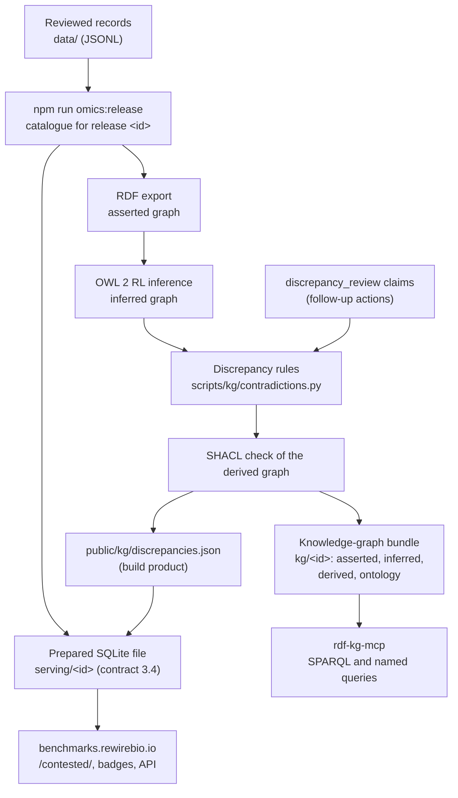
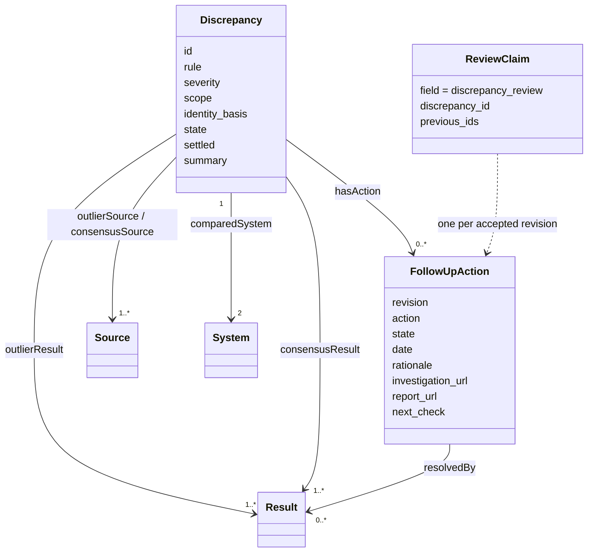
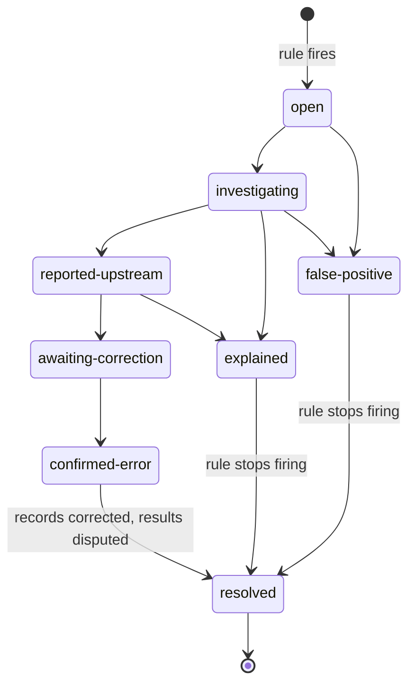

# Discrepancies between studies

When one study reports results for two systems that disagree with what other studies report for the same systems, the database flags it. Each flag is a **discrepancy**: a lead to investigate, not a finding that any result is wrong. Discrepancies are inferred from all the evidence on every release, published in the serving database and the knowledge-graph bundle, shown on the website, and queryable over MCP. The work done to resolve each one is recorded as a series of follow-up actions and shown with it.

This page is the reference for the whole feature. The rules' internals are in `scripts/kg/contradictions.py`, and the thresholds in `data/ontology/discrepancy-rules.json`. Rules version 4 came from [ADR 0001](adr/0001-comparable-evidence.html); [the design](design/discrepancy-rules-v4.html) explains it with worked examples.

## Why it exists

In October 2026 an AlphaGenome developer pointed out that a published splicing result (Alavi 2026) could not be right. The cause was an off-by-one error in the preprint's scripts. Other studies in the database already ranked the same models the other way, so the disagreement was visible in our own evidence; nothing looked for it ([#174](https://github.com/rewire-bio/rewire-benchmark-data/issues/174)). Discrepancies make that check automatic, and make the follow-up visible to readers.

## How it fits together



One release produces both outputs from the same inference, in this order, in `.github/workflows/release.yml` (`npm run build:release`):

1. Build the release catalogue from the reviewed records.
2. Build the knowledge graph: export, OWL 2 RL inference, SHACL, then the discrepancy rules, which write the derived graph and `public/kg/discrepancies.json`.
3. Build the prepared SQLite file, which copies the findings into its discrepancy tables. The release build refuses to continue without findings for the same release (`--require-discrepancies`).
4. Publish `serving/<id>` and `kg/<id>`, then ask the website to adopt the release once.

The website reads only the SQLite file. The knowledge graph is the only place the rules run, so the site, the API and MCP clients always see the same findings for a release.

## What the rules flag

A **comparison** is two systems' values within one group of one study's results: the same protocol, dataset, metric, unit, qualifier, split and direction. Values within the tie tolerance (1%) do not count. A **study** is a set of sources that share results, a DOI (a paper and its supplement), a GitHub repository, or a `companion_of` link (a paper's repository, leaderboard, supplement or other version). Each study uses one configuration per model for all its groups: the one with the most results in that study, then the larger model size, then the ID. So a model's sizes or checkpoints are not mixed, a different one per metric ([#206](https://github.com/rewire-bio/rewire-benchmark-data/issues/206)).

A study's **verdict** on a pair of systems is the system that scored better in at least 75% of its untied comparisons, or "split". A study with fewer than two untied comparisons gives no verdict. Studies, not rows, are counted: a paper that reports 150 numbers is one opinion ([#201](https://github.com/rewire-bio/rewire-benchmark-data/issues/201)).

| Rule | Flags when |
| --- | --- |
| Ordering reversal | At least two other studies give a verdict, at least 80% of them agree that A is better, and this study's verdict is B. This study is the outlier. |
| Two-study conflict | Exactly two studies give a verdict on the pair, and they disagree. There is no consensus to stand out from, so neither is named the outlier ([#205](https://github.com/rewire-bio/rewire-benchmark-data/issues/205)). |
| Gap outlier | At least three studies report the same metric on the same protocol, task or benchmark, and every one of them measured a common reference system. This study's median relative gap between a system A and the reference, (A - ref) / ref, lies more than 0.10 outside the range of the other studies' gaps. Never above medium severity. |

**The gap rule's reference.** A comparison group is one anchor (a protocol, or a task or benchmark it belongs to) and one metric, with at least three studies. The reference is a system that every study in the group measured. If more than one qualifies, a named baseline wins: a system that a baseline record is `implemented_by`, or that a use case's `baseline` claim names in `method_ids` ([#121](https://github.com/rewire-bio/rewire-benchmark-data/issues/121)). Otherwise the system with the lowest IRI is used. Every other shared system is compared with that reference. A group in which no system was measured by every study is skipped. When a system, reference and study fire on several anchors, the most specific anchor is kept: protocol, then task, then benchmark. On the store at release `2026-10-23-a1a0ac69daa3`, rules version 3 find no gap outliers.

**What is not compared.**
- Copied results: origin `paper_compilation`, or an `original_evaluation` link.
- Results marked `disputed`.
- Results covered by a source's `evidence_concerns`: all of that source's results, or, when the concern lists `applies_to`, the named records and the results resting on them.

A concern without `applies_to` (or with an empty list) covers every result that cites the source, directly or through its evaluation. A result on a scoped concern's path is one whose result, evaluation, tested configuration, dataset, the protocol, task or benchmark it was tested on, or what that is directly `part_of`, is named in `applies_to`, from any source. These are the same rules the website and use cases apply (`shared/omics/concerns.ts`, `evidencePath` and `sourceWideConcern`); `_excluded` in `scripts/kg/contradictions.py` implements them in Python, and a change to one must be made to the other.

A confirmed error therefore stops re-firing once it is recorded. The bundle manifest's `derived.excluded` and the top-level `excluded` in `discrepancies.json` count the results left out: `disputed` (by status) and `concern` (by an evidence concern). With rules version 3, the evidence concern exclusion removed 6,712 results and the disputed exclusion none. That is why 37 findings from version 2 stopped firing (32 low, 5 medium), and 4 new ones appeared where the consensus changed: 254 findings became 221 ([the 2026-10-23 review](reviews/2026-10-23-discrepancy-identity.md)).

**Identity.** A configuration is compared as the model it configures (`configuration_of`, then `family`, then `alias_of`). Links without a checked claim are still used, and the finding is marked `identity_basis: unreviewed`. A configuration with a `combination_rule` (a union, intersection or vote over other systems, with its members as `uses_model` links) is compared as itself, and never against one of its own members ([#204](https://github.com/rewire-bio/rewire-benchmark-data/issues/204)).

**Scope.** Each finding says how closely its two sides' assessments match:

| Scope | When |
| --- | --- |
| `same-protocol` | the two sides share a protocol |
| `same-task` | they share a task, benchmark or suite: what each assessment sits within, and the tasks that any of those evaluate |
| `unknown` | neither, and an assessment on either side has no task, benchmark or suite link; the finding lists them in `unlinked_protocols` ([#208](https://github.com/rewire-bio/rewire-benchmark-data/issues/208)) |
| `different-task` | neither, and every assessment is linked |

**Severity.** The scope sets the highest level: high for same-protocol and same-task, medium for unknown, low for different-task. A finding is limited to medium unless it is an ordering reversal with at least three consensus studies; the gap rule and two-study conflicts never go above medium. It then drops one step for unreviewed identity, and one for a variant mismatch (the studies used configurations with different recorded model sizes). Nothing raises a finding.

**Listing.** A finding is `public`, for the default contested page, when its scope is same-protocol or same-task, or a reviewer is working on it (investigating, reported upstream, awaiting correction, or confirmed error). Otherwise it is `review`: still in the bundle, the API and MCP, but listed for curation rather than as a public lead.

**Hand-reviewed findings.** `scripts/kg/fixtures/labelled-findings.json` lists the findings reviewed by hand and what the review found. The build fails if a real error or lead loses its finding, or its live finding is not public, and reports every outcome in the bundle manifest (`derived.labelled_findings`). The manifest also lists `derived.split_study_candidates`: benchmarks with results from both a DOI study and a repository or single-source study, which may need a `companion_of` link.

**IDs.** A finding's ID is `discrepancy-` plus the first 16 hex characters of the SHA-256 of its key, written as JSON with sorted keys and no spaces. The key is published as `key` in `discrepancies.json` and as `rb:discrepancyKey`:

| Key field | Value |
| --- | --- |
| `rule` | `ordering-reversal`, `two-study-conflict` or `gap-outlier` |
| `systems` | the two compared models or methods, after `configuration_of`, `family` and `alias_of` resolution, as sorted record IDs |
| `anchor` | for a gap outlier, the protocol, task or benchmark ID of its comparison group; `null` for the ordering rules, which pool every comparison of their two systems |
| `metric` | for a gap outlier, the metric concept key; `null` for the ordering rules |
| `outlier_study` | `doi:<lowest DOI among the study's sources, lower case>`, else `repository:https://github.com/<owner>/<repo>` (lowest), else `source:<ID of the source with the earliest retrieved_at>` (ties broken by ID; records have no creation date). Not used by a two-study conflict |
| `studies` | a two-study conflict only: both study keys, sorted, in place of `outlier_study` |

For example, the Alavi finding's key is `{"anchor":null,"metric":null,"outlier_study":"doi:10.64898/2026.10.02.756289","rule":"ordering-reversal","systems":["catalog-model-alphagenome","regulatory-variant-20261009-model-borzoi"]}`, giving `discrepancy-52a714eb6bb63442`.

Adding a source to a study, or another configuration of the same model, does not change the ID. When a rule change does change IDs, a review claim lists the old ID in `previous_ids`; the build maps it forward, and readers still find the finding under the old ID.

**Orphan check.** The build fails if an accepted review claim names an ID that no finding has, directly or through `previous_ids`, and the claim's latest revision has not settled it. So a review in progress can never be dropped silently. A settled review (`explained`, `confirmed-error` or `false-positive`) whose finding no longer fires is retired instead: a confirmed error stops firing once its results are disputed. A retired finding is kept as a resolved finding (see [Resolved findings](#resolved-findings)), and its ID is also listed in the bundle manifest's `derived.retired_reviews`. The build also fails if two accepted claims for one finding share a revision, or if `previous_ids` map one old ID to two findings.

**What a finding never does.** It never changes a record's status, value or links. `check_derived` and the derived-graph SHACL shapes (`data/ontology/derived-shapes.ttl`) fail the build if the rules write anything but discrepancy and follow-up statements. On the website a finding marks results as contested; it does not withhold them. Results are withheld only by a reviewer: through the `disputed` status, or a scoped evidence concern ([collection.md](collection.md)).

## Data model



Each accepted review claim revision becomes an `rb:FollowUpAction` node, `<discrepancy IRI>/action/<revision>`, linked from the discrepancy by `rb:hasAction`:

| Property | Value |
| --- | --- |
| `rb:actionRevision` | the claim's `revision` (xsd:integer) |
| `rb:reviewClaim` | the claim |
| `rb:resultingState` | the state after the step (`discrepancy-state` concept) |
| `rb:actionType` | the claim's `action` (`discrepancy-action` concept); absent for a state change only |
| `rb:actionDate` | the claim's `date`, else its `reported_on` (xsd:date) |
| `rb:actionUrl` | the claim's `report_url`, else its `investigation_url` |
| `rb:nextCheck` | the claim's `next_check` (xsd:date) |

The latest revision also sets the discrepancy's `rb:reviewState` and `rb:reviewClaim`. A discrepancy carries `rb:previousIds` for each old ID mapped to it. `data/ontology/derived-shapes.ttl` holds the SHACL shapes for all of this.

`rb:Discrepancy` is a SEPIO assertion (SEPIO_0000001). Its evidence links are subproperties of SEPIO `has_supporting_evidence` and `has_supporting_evidence_from_source`. `rb:assertionMethod` is ECO `automatic assertion` (ECO_0000203) until a reviewer acts, then `manual assertion` (ECO_0000218). The rule concepts match STATO `ranking` and `relative difference`. The terms are in `data/ontology/rb.ttl`; the states are in `data/vocab/discrepancy-state.ttl` and the action types in `data/vocab/discrepancy-action.ttl`.

## Following one up



Each step is a claim with `field: discrepancy_review`, reviewed like any other record. Its main fields:
- `discrepancy_id`, the finding's ID;
- `revision`: 1, 2, 3 and so on;
- `action`, what was done (from `discrepancy-action.ttl`);
- `date`, when it was done;
- `value`, the state after the step;
- subject links to the results involved.

The highest revision sets the current state. Every revision is kept and published as one follow-up action, so the site shows the whole history.

| Attribute | Holds |
| --- | --- |
| `action` | investigated, contacted-authors, reported-upstream, awaiting-correction, reran, corrected-records or closed |
| `investigation_url` | Our own analysis: an issue, a dated review |
| `date` | When this step was taken. If absent, the action's date is `reported_on` |
| `report_url`, `reported_on` | What we raised with the authors, and when |
| `upstream_response` | What they said |
| `awaiting`, `expected_by` | What has to happen next, and when they said it would |
| `next_check` | When to chase it. Published as a date; readers decide what is overdue |
| `resolved_by` | The corrected source or superseding results, once they exist |
| `rationale` | Why the state is what it is |
| `previous_ids` | Earlier IDs of the same finding, if a rule change re-keyed it |

Only `explained`, `confirmed-error` and `false-positive` settle a finding. A confirmed error is fixed by a normal reviewed record change that marks the affected results `disputed` and, when corrected values exist, adds superseding results. From then on the rules no longer compare those results.

### Resolved findings

A settled finding often stops firing: once a confirmed error's results are marked `disputed`, the rules no longer compare them. The finding is then kept as a **resolved finding**, so its follow-up stays visible on the site, in the API and over MCP. A finding that stops firing without being settled still fails the build (the orphan check).

A resolved finding is built from its review claims, not from the rules:

| Field | Value |
| --- | --- |
| `id`, `previous_ids` | the claims' `discrepancy_id` and the old IDs mapped to it |
| `resolved` | `true` (`false` for every live finding) |
| `review_state`, `review_claim`, `settled` | the latest revision's state and claim; always settled |
| `actions`, `resolution` | the full follow-up history and the latest revision's resolution, as for a live finding |
| `summary` | the latest revision's `rationale`, else a sentence giving the state |
| `systems`, `label` | the models or methods tested by the claims' subject results and evaluations, resolved like compared systems (empty if more than two), and a label naming them, e.g. "AlphaGenome and Borzoi: resolved" |
| `severity` | `low`: no record holds the severity it last fired with |
| `rule`, `key`, `scope`, `identity_basis` | `null`: the rule it last fired with is not recorded |
| `studies`, `numbers`, sources and results | empty |

In `discrepancies.json` (schema 4) resolved findings follow the live ones. The bundle manifest counts them apart from the live findings: `derived.discrepancies`, `by_rule`, `by_severity` and `by_review_state` count live findings only, and `derived.resolved` and `resolved_by_review_state` count resolved ones. In the serving file a resolved finding has rule `""`; it is settled, so the open filter (`settled: "open"`) leaves it out. It has no results, so it marks nothing as contested.

In the derived graph a resolved finding is an `rb:Discrepancy` and an `rb:ResolvedDiscrepancy`, with its label, summary, severity, review state, review claim, compared systems, previous IDs and follow-up actions, but no rule, key, evidence links or numbers. `open_discrepancies` leaves it out, `discrepancy_history` returns its actions, and `discrepancies_for_system` lists it when its systems are known. The SHACL shape `rbs:ResolvedDiscrepancy` requires a settled state and at least one action.

**Worked example.** Alavi 2026 ranked AlphaGenome below other splicing models, against the consensus of the other studies.
1. The rule flagged it as an ordering reversal.
2. We traced it to an off-by-one in the authors' scripts and reported it upstream on 19 October 2026.
3. The author confirmed the error and is rerunning.

The claims are in `data/omics/discrepancy-review-20261022-alavi-alphagenome/`. The finding's current state is `awaiting-correction`, with a next check on 10 November 2026. Rules version 3 re-keyed it from `discrepancy-ead251c24ba272c1` to `discrepancy-52a714eb6bb63442`; its claim keeps the old ID in `previous_ids` and records the step as `action: reported-upstream`, dated 19 October 2026 from `reported_on`.

## Where to read them

### Serving database (contract 3.3, 3.4)

The website and API read these tables from `catalogue-<id>.sqlite` ([serving-contract.md](serving-contract.md)):

| Table | Content |
| --- | --- |
| `discrepancies` | one row per finding, in display order (`pos`, most severe first): `rule`, `severity`, `scope`, `listing` (from 3.4), `state`, `settled`, and the full finding gzipped |
| `discrepancy_results` | `result_id`, `discrepancy_id`, `role` (`outlier`, `consensus`, or from 3.4 `party` for a two-study conflict) |
| `discrepancy_systems` | `system_id`, `discrepancy_id` |
| `discrepancy_actions` | one row per follow-up action: `revision`, `action`, `state`, `date`, `next_check`, and the action gzipped |
| `discrepancy_aliases` | `previous_id` to current `discrepancy_id` |
| `blobs.discrepancy_index` | list entries for every finding, the rules in force and the exclusion counts |

`shared/omics/prepared-catalogue.ts` reads them:
- `discrepancies({ severity, state, settled, system, rule, listing, cursor, limit })`; the page's `counts` include `listing`
- `discrepancy(id)`
- `contestedBy(resultIds)`
- `discrepanciesForSystem(id)`
- `discrepancyActions(id)`
- `discrepancyRules()`
- `hasDiscrepancies()`

A file built before 3.3, or without the knowledge graph, has no findings, and every reader returns empty. `npm run serving:parity` checks that the tables hold exactly the knowledge-graph build's findings.

### Studies in a finding

From `discrepancies.json` schema 3, each finding carries `studies`: every study that compared its two systems, with the outlier (or a conflict's two parties) first and then the others by number of comparisons (most first), then key. The serving tables store it inside the gzipped finding, so `discrepancy(id)` returns it; a finding read from a schema 1 or 2 file has an empty list.

| Field | Value |
| --- | --- |
| `key` | the study key, in the same form as the ID's `outlier_study` |
| `role` | `outlier`, `consensus`, or `party` for a two-study conflict |
| `verdict` | from schema 5: the system the study's comparisons favour, `split`, or `null` when it has too few untied comparisons for a verdict |
| `configurations` | from schema 5: for each of the finding's `systems`, the configuration (or model) whose values the study used |
| `source_ids` | the sources that make up the study |
| `higher` | for each of the finding's `systems`, the number of comparisons in which it scored better |
| `ties` | comparisons within the tie tolerance |
| `gap` | gap rule only: the study's median relative gap to the reference; `null` for an ordering reversal |
| `comparisons_total` | all of the study's comparisons of the two systems |
| `comparisons` | at most 200 of them, ordered by protocol, dataset, metric, unit, qualifier and split |

Each comparison gives its `protocol`, `dataset`, `metric` and `unit` (concept keys), `qualifier` and `split`, the two systems' best `values`, the result each value comes from (`results`; the first by ID when several results share the best value), and `higher`, the better system or `null` for a tie. `higher` and `ties` always add up to `comparisons_total`.

`studies` can list more studies than `consensus_sources`. An ordering reversal's consensus counts only studies with a verdict, so a study whose comparisons of the pair are all ties, or too few, is in `studies` (role `consensus`, `verdict` null) but not in `consensus_sources`.

Schema 5 (rules version 4) also adds, per finding: `listing`, `variant_mismatch`, `unlinked_protocols`, and for a two-study conflict `party_sources` and `party_results` (its `outlier_*` and `consensus_*` lists are empty). An ordering reversal's `numbers` add `consensus_studies` and `consensus_study_agreements`; a conflict's are `{"studies": 2}`. A finding read from an earlier file is `public`, with no variant mismatch, unlinked protocols or parties. For the gap rule the two lists hold the same studies.

The per-study breakdown is not in the derived graph: one row per comparison would make it much larger. The graph keeps the outlier and consensus sources and results.

### Knowledge graph and MCP

The bundle's `derived.nq` holds the findings and their actions in the graph `https://benchmarks.rewire.it/graph/derived`. With [rdf-kg-mcp](https://github.com/rewire-bio/rdf-kg-mcp) 0.2 or later, the bundle's named queries answer the same questions as the site:

| Query | Parameters | Returns |
| --- | --- | --- |
| `open_discrepancies` | `severity` (string, optional: `high`, `medium` or `low`) | unsettled findings, most severe first |
| `discrepancies_for_system` | `system` (IRI, required, e.g. `id:catalog-model-alphagenome`) | every finding comparing that model or method, settled or not. Configurations are compared as their model, so pass the model or method |
| `discrepancy_history` | `discrepancy` (IRI, required, e.g. `id:discrepancy-52a714eb6bb63442`) | the finding's follow-up actions in revision order: type, resulting state, date, URL, next check, claim |
| `contested_results_for_use_case` | `use_case` (IRI, required, e.g. `id:use-case-patient-rna-splicing-validation`) | results on the use case's protocols that an unsettled finding rests on, with their role (`outlier` or `consensus`) |

Install the server with `uvx --from git+https://github.com/rewire-bio/rdf-kg-mcp@v0.2.0 rdf-kg-mcp serve <bundle>` ([linked-data.md](linked-data.md#bundle)). `list_queries` lists them and `run_query` runs one. `sparql_query` with `graphs: ["derived"]` runs any other read-only query, for example:

```sparql
PREFIX rb: <https://benchmarks.rewire.it/vocab#>
SELECT ?d ?severity ?state WHERE {
  GRAPH <https://benchmarks.rewire.it/graph/derived> {
    ?d a rb:Discrepancy ; rb:severity ?severity ; rb:reviewState ?state .
  }
} ORDER BY ?severity
```

### Website

The website shows:
- `/contested/`: every finding, with filters for severity, state and model;
- `/contested/<id>/`: the studies that agree with the consensus and the one that disagrees, as a table and a chart of each study's comparisons (from `studies`), the results and sources, and the follow-up timeline, marking a `next_check` that has passed;
- a "Contested" badge on use-case rows and result pages built on an unsettled finding;
- a count on model pages.

See `docs/contested-results.md` in rewire-database.

## Changing the rules

Change the thresholds in `data/ontology/discrepancy-rules.json`, bump its `version`, and record why in a dated `docs/reviews/` file. The rules and their thresholds are part of the release coverage (`discrepancy_generator_sha256`), so a rule change cuts a new release even when no record changed. If the change re-keys findings that have review claims, add the old IDs to `previous_ids` in the same pull request; otherwise the build fails. `scripts/kg/migrate-discrepancy-ids.py` writes those claims: it derives the new findings, matches each re-keyed review to the new finding of the same two systems and study, and writes the next revision of the claim with the same state and resolution. Two old IDs cannot both map to one new finding (their revision 1 claims would collide), so the longest chain is carried forward and the other must be settled, to retire as a resolved finding.
