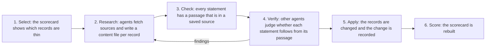
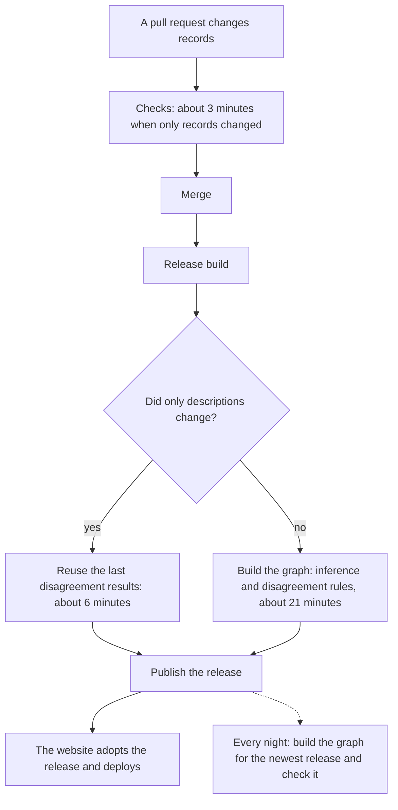

# How the knowledge base is built

This is the plain description of how a fact gets from a paper or a repository into the Rewire
benchmark database, onto the website and into the knowledge graph. Read this first. The other
documents in this folder go into detail on one part each.

The system is being rebuilt to one design. [rebuild.md](rebuild.md) has that design, the plan and the state of each step; this page describes how things work today.

The numbers on this page were measured on 26 November 2026. The current ones are in
[scorecard.md](scorecard.md).

## What it is

The knowledge base is a set of plain text files in this repository. Each line of a file is one
record. A record says one thing: this is a model, this is a benchmark, this paper reports this
score. Every record names the sources it came from.

The website ([benchmarks.rewirebio.io](https://benchmarks.rewirebio.io)) and the knowledge graph
are both built from these files. Nothing is edited on the website. To change what a page says,
change a record.

## The stages, and where each stands

Turning papers into a store that can be compared and checked is a known problem with known stages:
keep the documents, extract what they claim against a fixed schema, tie every name to one
identifier, merge what is the same, then look for disagreements. This table is the plan the rest
of the page follows. A stage is in place when it has a schema, a written brief, a mechanical check
and a measured error rate.

| Stage | What it does | State on 26 November 2026 |
| --- | --- | --- |
| 1. Keep the documents | Each source is a record with its address and a hash of the bytes | In place |
| 2. Extract against a schema | An agent fills fixed fields from the fetched text, with a copied passage behind each value | In place for model descriptions (1.6 percent of statements needed correction). Results were extracted earlier by one-off scripts per paper and by hand; agents do not yet extract results |
| 3. Tie names to one identifier | "The same model", "the same checkpoint" and "the same test" each resolve to one record | The weak stage. Each paper's test is its own protocol, 20 model names sit on two records, and checkpoints are told apart only by free text |
| 4. Merge what is the same | Two sources reporting on the same checkpoint and the same test become two observations of one thing | Not possible until stage 3 is done |
| 5. Find disagreements | Observations of one thing that differ, and pairs ranked oppositely | Rules exist for rankings. They find little because of stage 3 |
| 6. Report on a new document | What a new paper confirms, contradicts and adds | Not built. New models are added by name only |
| Inference over the graph | Derive facts no source states | Built early. It is the last thing a store like this needs |

The order of work follows from the table: stage 3 first, because stages 4 to 6 wait on it.

## The records

| Record | What it is | Example |
| --- | --- | --- |
| Source | A paper, a repository file or a model card, with the address it was fetched from and a hash of the bytes | The Caduceus README at one commit |
| Model | A trained model or a family of them | Caduceus |
| Configuration | One specific way a model was run: a checkpoint, an input, zero-shot or fine-tuned | Caduceus-PS, 131k context, fine-tuned |
| Method | A tool or algorithm that is not a trained model | CADD, a splicing outlier caller |
| Benchmark | A published test suite | ProteinGym |
| Task | A question a benchmark asks, which several papers can answer | Zero-shot prediction of mutation effects |
| Protocol | One paper's exact procedure for a test: data, split, metric | The ProteinGym v1.3 zero-shot average over 217 assays |
| Dataset | The data a protocol runs on | The BRCA1 saturation genome editing variants |
| Evaluation | One system run on one protocol, in one source | Evo 2 7B on the BRCA1 protocol, in the Evo 2 paper |
| Result | One number from an evaluation, with the table and row it was read from | AUROC 0.904 |
| Use case | A decision a scientist or lab has to make | Choose a predictor for missense variant interpretation |
| Claim | A judgement that needs its own evidence: a correction, a relevance rating, a decision on a disagreement | "This protocol is direct evidence for this use case" |

Two things about the records matter more than the rest:

1. **A result belongs to an evaluation, and an evaluation to a configuration and a protocol.** So
   a number is never just "Evo 2 scored 0.90". It is "this checkpoint, run this way, on this data
   with this metric, according to this source".
2. **Every paper's test was recorded as its own protocol.** That keeps the detail exact, and it
   also means two papers that ran the same test do not share a record. See
   [Comparing results across papers](#comparing-results-across-papers).

## How a fact gets in

Records are filled in batches, by the same loop every time.

1. **Select.** `python3 scripts/enrich/enrich.py select <work dir> --tier 1 --count 25` picks the
   records most in need of work and writes a folder for each.
2. **Research.** Research agents work from one brief
   ([scripts/enrich/briefs/model-page.md](../scripts/enrich/briefs/model-page.md)). For each
   record they fetch the primary sources (the repository README at a fixed commit, the model
   card, the paper), save the files, and write a content file. The rule in the brief that matters
   is this: every statement is written from the fetched text, never from memory, and carries a
   passage copied from a saved file.
3. **Check.** `scripts/enrich/check_spec.py` confirms each passage really is in its file and each
   file matches its hash. This is mechanical and catches invented quotes.
4. **Verify.** A passage being present does not prove the statement follows from it. Verifier
   agents that did not write the content read every statement against the sources
   ([scripts/enrich/briefs/verify.md](../scripts/enrich/briefs/verify.md)) and list what is wrong,
   partly supported or unsupported. Findings go back to be corrected.
5. **Apply.** `scripts/enrich/enrich.py prepare` and `models` turn the checked content into store
   changes. New sources are added as source records with their hash. The changed records are
   recorded with `npm run records -- change`, which names the review document that justifies
   them.
6. **Score.** `python3 scripts/enrich/scorecard.py --write` rebuilds
   [scorecard.md](scorecard.md).

Each batch leaves a folder under `data/omics/` with the content files (including the passages), and
a review document under `docs/reviews/` that says what changed, how it was checked and what was
left open.

### How good is the output

On 26 November 2026 four batches filled 89 model pages. Verifier agents then read all 2,369
statements: 4 were wrong and 34 added a detail the source does not give, 1.6 percent together. All
38 were corrected. No run instruction on a model page has been executed yet; each one says so.

## What a complete record looks like

A model record is complete when its page can answer five questions.

| Question | Where the answer is stored |
| --- | --- |
| What is it for? | `profile.summary` |
| How does it work? | `profile.sections`, `profile.diagram` |
| Which sizes and versions exist, and on what terms? | `profile.facts`: twelve fixed facts, among them parameters, context limits, training data, weights licence and code licence |
| How do I run it? | `run_guide`: commands from the developers' documentation, pinned to a commit |
| How has it scored? | Results, through its configurations |

Where the developers do not state something, the fact says so (`unreported`), which is different
from nobody having looked (`unextracted`).

Content files written since 26 November also carry a `structured` list: one entry per released
checkpoint with the parameter count and context length as numbers, licences as identifiers, and
addresses for code and weights. These are kept in the batch folders and are not yet loaded into
the records.

## From the files to the website and the graph

- **Checks.** A pull request that changes only records has its changed records validated
  (`scripts/ops/changed-records.py`). Anything that touches code, the vocabulary or the workflows
  validates the whole store.
- **Release.** Every merge to `main` starts a release build. Releases run one at a time.
- **Disagreements without the graph.** The graph's inference and its disagreement rules took
  about 15 minutes of every release build. A release now loads the store into one database
  (`kb/migrate.py`) and finds the disagreements from it (`kb/discrepancies.py`) in about 15
  seconds. The output is the same file, byte for byte.
- **The nightly graph.** `kg-release.yml` runs at 01:37 UTC. It builds the knowledge graph bundle
  for the newest release if that release has none, and fails if its disagreement results differ
  from the ones the website is serving. So the graph is at most a day behind the website, and a
  difference between the database's answer and the graph's is caught within a day.
- **The website.** It copies the release, runs its own tests against it and deploys. A pipeline
  alert opens an issue if any step fails.

More detail: [release.md](release.md).

## Comparing results across papers

This is the part of the format that is still being built.

Because each paper's test is its own protocol, the store today holds mostly isolated islands. On
26 November 2026, 19 of 1,551 protocols with results held results from two or more studies, and 79
of about 26,000 model, test and metric combinations were measured by more than one study. The
overlap exists in the literature. It is not yet linked in the records.

The fix has three parts.

1. **Settings.** A setting is one test that different papers could run and get comparable numbers
   on. Protocols from different papers link to the setting, each with a grade: `same` (the
   numbers should agree), `near` (same data and metric, a stated difference such as a version or a
   subset) or `related` (same benchmark family, not comparable number for number). The grade and
   the stated differences are a claim, so they have their own evidence and can be corrected.
2. **Comparison at the checkpoint.** "Evo 2" is not one thing to compare: 40B, 7B and 7B base
   score differently, as do CADD v1.3 and v1.7. Comparison is made between configurations that
   name the same checkpoint or version.
3. **Rules.** With settings in place, two kinds of disagreement can be found by rule: the same
   checkpoint scoring differently in two sources on the same setting, and two sources ordering a
   pair of models oppositely. The second already exists (see [discrepancies.md](discrepancies.md)).

A pilot on three clusters is recorded in
[data/omics/comparison-settings-pilot-20261126](../data/omics/comparison-settings-pilot-20261126/README.md).
It linked 61 protocols into 21 settings and surfaced 19 disagreements.

Leaderboards use the same structure. A board ranks one use case on one setting. A row is exact
when Rewire ran it or when the sources are graded `same`, and an estimate, labelled as one, when
it rests on `near` settings.

## Common jobs

| I want to | Do this |
| --- | --- |
| See how complete the database is | Read [scorecard.md](scorecard.md) |
| Fill in a batch of model pages | Follow the six steps above. A finished example is `data/omics/model-pages-20261126-batch1/` and its review in `docs/reviews/` |
| Correct something on a page | Edit the record, write a short review saying why, run `npm run records -- change`. See [collection.md](collection.md), "Corrections and concerns" |
| Add results from a paper | [collection.md](collection.md) |
| Add a new model | Open an issue labelled `entity-request`; the intake agent opens the pull request |
| Understand a disagreement finding | [discrepancies.md](discrepancies.md) |
| Query the graph | Use `rdf-kg-mcp` with the newest `kg/<id>` release. See [linked-data.md](linked-data.md) |

## Where things live

| Path | What |
| --- | --- |
| `data/entities/` | Models, methods, benchmarks, protocols, datasets, sources, one file per kind |
| `data/evidence/` | Evaluations, results and claims |
| `data/provenance/` | For each record, its hash, the batch that added it and every recorded change |
| `data/omics/<batch>/` | The working files of one batch |
| `docs/reviews/` | One review document per batch or change |
| `scripts/enrich/` | The batch tools and the agent briefs |
| `scripts/kg/` | The knowledge graph export, inference and disagreement rules |
| `scripts/release/` | Release packaging |
| `.github/workflows/` | Checks, release, nightly graph, and the agents that run on a schedule |

## Known gaps

- Benchmarks, methods and most Tier 2 and Tier 3 models have no profile yet.
- No run guide has been executed. An executed guide needs a status the schema does not have yet.
- Settings are a pilot. No setting record or same-checkpoint rule exists yet.
- The structured checkpoint facts are collected and not yet loaded into the records or the graph.
- Agents add models and sources. They do not yet add results from papers.
- Some source records hash a file derived from the address they name (text extracted from a PDF, a
  file taken out of an archive) and do not yet say so.
