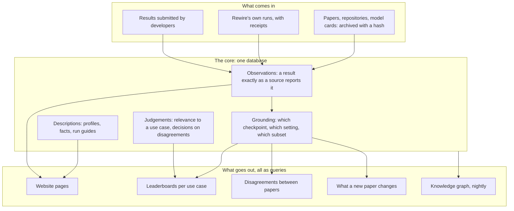

# The rebuild: one design for the knowledge base

Decided by the owner on 26 November 2026 (issue 274): rebuild the system as one coherent design.
This document is the design, the plan and the status. It is updated as the work moves.

Read [knowledge-base.md](knowledge-base.md) first for what the knowledge base is and the stage
plan this design follows.

## Why

The system grew as a series of repairs. Extraction was done by about 148 one-off scripts, one per
paper. A TypeScript record store with a hash chain over every record was added to hold the output.
A Python port was written to reproduce the TypeScript byte for byte. An OWL and SHACL graph was
put on the release path. Each layer works, and together they make every change slow.

Three things the system should do, it cannot:

1. **Compare results across papers.** 19 of 1,551 protocols with results hold results from two or
   more studies, because each paper's test is its own record.
2. **Say what a new paper changes.** Agents add a model's name and nothing else.
3. **Answer a factual question.** Parameter counts, licences and context lengths are prose.

## What "rebuild" means here

- One design for the whole pipeline. The earlier layers are deleted once the new one has run
  beside them.
- The existing records are **migrated, not re-extracted**. The migration is a function of the
  current store that runs on every release, so nothing freezes while the rebuild is under way.
- The website keeps running on today's serving file until the new core produces that file.
- What outsiders can see does not move: record IDs, page addresses, discrepancy IDs, the `/api/v1`
  paths and the named graph queries.

## The design



### One database

The source of truth stays as plain text files in git, because pull requests, review and history
all work on text. From those files one command builds a single SQLite file. Everything else reads
that file. Building it takes seconds, so nothing needs to be incremental or cached.

### Four kinds of table

| Kind | What it holds | Where it comes from |
| --- | --- | --- |
| Observations | A result exactly as a source reports it: the system as named, the test as described, the metric, the value, the table and row | Extraction, with a copied passage behind each row |
| Grounding | Which released checkpoint a named system is. Which setting a described test belongs to, graded `same`, `near` or `related`. Which subset of the data a result is for | A separate step, by agents, checked like any other |
| Descriptions | What a model or benchmark is, how it works, its facts as typed values, how to run it | The model page loop that already exists |
| Judgements | How relevant a setting is to a use case. What was decided about a disagreement and what was raised with the authors | People, and agents with review |

Keeping observations and grounding apart is the centre of the design. An observation never
changes when our understanding of what it measured improves. Grounding can be corrected without
touching what the paper said. A disagreement is then a query: observations of the same checkpoint
on the same setting and subset, from different studies, that differ.

### Everything else is a view

Comparable results, disagreements, leaderboards, scorecards and the "what does this paper change"
report are queries on the database. None is stored, so none can go stale, and each takes seconds.

### The graph is an export

The knowledge graph is built from the database every night for agents and for anyone who wants
linked data. No release waits for it and no inference runs on the release path.

### One loop for every stage

Extraction, grounding and description all use the same loop: a written brief, fixed fields, a
copied passage behind every value, a mechanical check, an independent verifier, and a measured
error rate. See [knowledge-base.md](knowledge-base.md).

## What exists now

The first slice is in `kb/`.

| File | What it does |
| --- | --- |
| `kb/inventory.py`, `kb/INVENTORY.md` | Every record kind, attribute, link and status in the current store, with counts. Nothing is dropped by the migration without appearing here |
| `kb/migrate.py` | Builds `kb/build/kb.sqlite` from the current store. `--check` reads every record back and compares it with the original |
| `kb/curation/` | The new information the old store has no place for: `settings.jsonl`, `protocol_settings.jsonl`, `grounding.jsonl` (exact system and subset per result), `difference_reviews.jsonl`, `leads.jsonl`. `notes/` holds the brief the grounding agent worked from and what it and its reviewer found |
| `kb/curate.py` | Loads the curation files, loads the structured facts from the batch content files (`checkpoint`: 407 released checkpoints of 178 model records; `benchmark_task`: 535 tasks of 98 benchmarks), and creates the comparison and fact views |
| `kb/board.py` | Estimates a leaderboard for each use case from within-study comparisons (Bradley-Terry), with each row labelled by how many studies it rests on |
| `kb/report.py` | For one source: what it measured, which of its numbers another study also reports, and which pairs of models it orders differently |
| `kb/discrepancies.py` | Finds disagreements between studies from `kb.sqlite` and writes `discrepancies.json`, with the same IDs and fields as `scripts/kg/contradictions.py` but without the graph or OWL inference (8 seconds instead of about 15 minutes) |
| `kb/queries.py`, `kb/search.py` | Answers all nine named graph queries from `kb.sqlite`, the release's `use-cases.json` and `discrepancies.json`, with the same columns and rows as the graph: the four discrepancy queries (open discrepancies, discrepancies for a system, the history of one, contested results for a use case) and the five product queries (ranking for a use case, gaps, recipes, results for a model, provenance). Also the three record tools the agents call on rdf-kg-mcp: `search` (the same index and ranking), `describe_resource` and `dataset_info`. `kb/tools/compare_queries.py` checks it against a published bundle |
| `kb/tools/import_pilot.py` | One-off: filled the curation files from the comparison settings pilot and the structured checkpoint facts |

Measured on 26 November 2026:

- The migration loads all 94,715 records in 4 seconds. Every one reads back equal to the original:
  id, kind, name, description, status, facets, sources, links and every attribute.
- The comparability counts that took a script and a 400 MB file now take one query and 1.6 seconds.
- With the 21 pilot settings loaded, 3,246 results fall in a setting, 33 model and setting
  combinations have values from two or more studies, 43 pairs of models are measured together by
  two or more studies, and in 4 of those the studies disagree on the order.

To try it:

```sh
python3 kb/migrate.py --check
python3 kb/curate.py
python3 kb/board.py --use-case brca1-brca2-germline-interpretation
python3 kb/report.py gfm-guides-20261014-evo2-brixi2026-source-supplementary-data-1
sqlite3 -header -column kb/build/kb.sqlite "SELECT * FROM setting_pair_v WHERE first_ahead > 0 AND second_ahead > 0"
```

### What the first slice already shows

The spread of values for one model in one setting is often far too wide to be a real disagreement:
0.31 to 0.85 for Nucleotide Transformer on ClinVar missense. Two things cause that, and both are
grounding that does not exist yet:

- **Subset.** One protocol holds results for coding and noncoding variants, or for several
  ClinVar cohorts, and nothing but a free-text locator says which.
- **Checkpoint.** "Nucleotide Transformer" is fourteen checkpoints. The link from a system to its
  model merges them.

So the next two tables to fill are the checkpoint of each system and the subset of each
observation.

### With grounding, then a review of it

An agent named the exact system and the subset for each of the 472 results in the ClinVar and
BRCA1 settings, from the record fields only. The wide spreads went away, leaving 13 cases where
two studies report different values for the same exact system on the same subset.

A second agent then checked every line without seeing the first agent's rules. It found 48 of 472
wrong (10.2%): 23 system keys, 19 subsets, 6 adaptations. The largest group was one study whose
results are for the variants that all 19 compared methods could score, which had been labelled as
the whole set. With the corrections applied, 12 differences remain, and the review gave each a
verdict (`kb/curation/difference_reviews.jsonl`):

| Verdict | Count | Example |
| --- | --- | --- |
| Lead worth raising | 3 | PhyloGPN on ClinVar missense: 0.799 (Lu et al. 2025) against 0.84 (PhyloGPN paper), on 50,820 variants, while GPN-MSA agrees between the same two studies |
| Artefact | 8 | Six gaps where the same precomputed GPN-MSA score file gives different values, which shows the variant sets differ, not the model |
| Unresolved | 1 | Evo 2 7B on BRCA1 coding variants: the two studies may define coding differently |

The method that separated them is worth keeping: a system that uses the same fixed scores in both
studies is a control. If the control differs, the cohorts differ and nothing can be said about the
other models. If the control agrees and another model does not, the difference is in how that
model was run.

Two lessons for grounding at scale. A single agent's grounding is not good enough to publish: one
line in ten was wrong, so the verifier pass is required, as it is for page content. And a
difference is not a disagreement until someone has looked for a control. The queries are
`SELECT * FROM grounded_lead_v` and, for new ones, `... WHERE verdict = 'not reviewed'`.

### Facts as values

Each page batch asks its research agents for a `structured` list beside the prose: one entry per
released checkpoint (parameters and context length as numbers, licences as identifiers, addresses,
gating, release date), or one per benchmark task (dataset, size, split rule, metric and direction,
addresses, licences), each value with a copied passage behind it and each judged by a verifier.
`kb/curate.py` loads them, so questions the prose could not answer are queries:

```sh
sqlite3 -header -column kb/build/kb.sqlite "SELECT name, checkpoints, largest_parameters, weights_licences FROM model_fact_v ORDER BY largest_parameters DESC LIMIT 10"
sqlite3 -header -column kb/build/kb.sqlite "SELECT weights_licence, count(*) FROM checkpoint GROUP BY 1 ORDER BY 2 DESC"
```

On 27 November 2026: 407 checkpoints, 205 with a parameter count, 268 with a licence stated for
the weights, 361 with an address for them, 9 gated. 535 benchmark tasks, 362 with a size, 526
with a primary metric. The first three page batches predate the `structured` list and are not
covered. Metric names are as the sources print them and are not yet normalised (`AUPRC`, `auPRC`).
The website does not show these values yet.

## Plan

| Step | What | Done when | State |
| --- | --- | --- | --- |
| 1 | Inventory of the current store | Every kind, attribute and link is listed with counts | Done |
| 2 | Migration as a repeatable function of the store | Every record reads back equal; runs in CI on every pull request | Done. The `kb` job runs it in 35 seconds |
| 3 | One slice end to end: ClinVar and BRCA1 | Checkpoints and subsets as fields; a board with no mixed rows; the pilot's 16 disagreements returned by a query | Done for differences: 472 results grounded, checked by a second agent (48 corrected), 12 differences returned by `grounded_lead_v` with a verdict each: 3 leads, 8 artefacts, 1 unresolved. Not done: a view of model pairs that studies order differently over grounded results, and new settings for the 175 results in the missense setting that are other variant classes |
| 4 | Grounding at scale | Every Tier 1 system has a checkpoint; every Tier 1 protocol is in a setting or marked as standing alone | Not started |
| 5 | The seam: the new core writes today's serving file | The website's own tests and data checks pass on it; sample pages render the same text | Part done. The release now finds its discrepancies from `kb.sqlite` (`kb/discrepancies.py`, byte-identical to the graph's file for release 2026-11-26-36acdf5e0cfa: 216 findings, same IDs). The records in the serving file still come from the old release builder |
| 6 | New writers | A batch of model pages, a batch of results and a correction each go in through the new core | Not started |
| 7 | New outputs | Use case boards built by query; a "what this paper changes" report for one new paper | First version of both: `kb/board.py` ranks all 31 use cases in 2 seconds, `kb/report.py` reports on one source in 2 seconds. Both compare at the model, not the checkpoint, until step 3 is done. Neither is on the website yet |
| 8 | Nightly graph from the new core | The named queries the gap scanner and the plugin use return the same answers | Part done. `kb/queries.py` answers all nine named queries from the database; for bundle 2026-11-26-36acdf5e0cfa its rows equal the graph's on all 276 parameter sets tried (89 of them for the four discrepancy queries). `search` indexes the same 94,461 records and discrepancies with the same classes and returns the expected record in the top 5 for 10,448 of the 10,771 gold pairs of `scripts/kg/search-gold.rq`, as the graph does. No agent reads the database yet; [agents-off-the-graph.md](agents-off-the-graph.md) is the plan |
| 9 | The website's data layer reads the new database directly | The compatibility export is no longer needed | Not started |
| 10 | Deletion | The old record tooling, the per-batch scripts, the release-time reasoning and the compatibility export are removed | Not started. Raised with the owner first |

The live cutover (step 5 going live) and the deletion (step 10) are each raised with the owner
before they happen.

## How we will know it was worth it

Three numbers, measured before and after.

| Measure | 26 November 2026 | Target |
| --- | --- | --- |
| Time to add one paper's results, from the paper to the live site | Not possible by agent; hours by hand | Under one hour, by agent, with verification |
| Model, test and metric combinations measured by two or more studies | 79 | At least ten times that |
| Merge to live | 41 minutes for a full release; 14 for a content-only one | Under 10 minutes for any change. Since 26 November every release finds its discrepancies from the database, and the site's 25-minute live check no longer holds the publish queue; to be measured on the next releases |

If these do not move, the rebuild has failed and the existing system should be kept.

## What must not break

- Record IDs, and the page address of every record.
- Discrepancy IDs and their review history.
- The `/api/v1` paths and their response shapes.
- The named queries in the graph: ranking for a use case, gaps, recipe for a model or benchmark,
  provenance, results for a model.
- Source archiving. Every source that is fetched is stored. A licence decides what may be
  published, never what is stored ([source-preservation.md](source-preservation.md)).

## Open design questions

- **Where a setting lives after cutover.** For now settings are curation files in `kb/curation/`.
  They may become records like any other.
- **Subset vocabulary.** A subset is free text today. It needs a small controlled list per setting
  (for BRCA1: all, coding, noncoding) with a fallback.
- **How a leaderboard row is chosen** when a model has several checkpoints and adaptations in one
  setting. The rule has to be stated on the board.
- **One repository or several** after cutover. A new repository needs the owner to enter secrets
  again, so the question is left until then.
